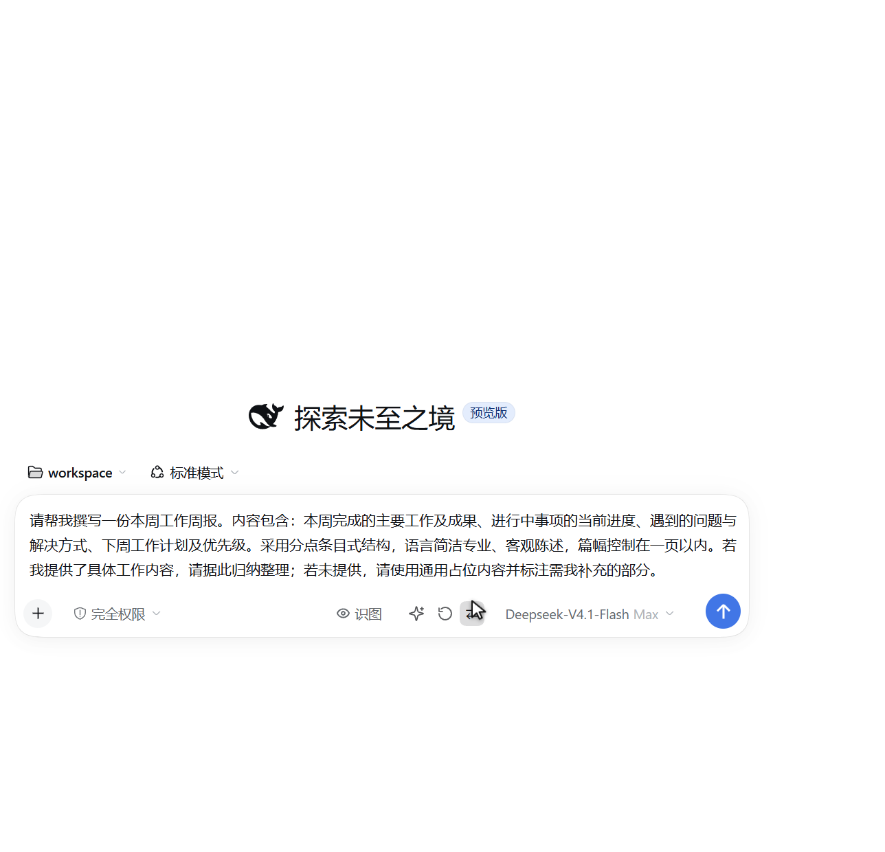
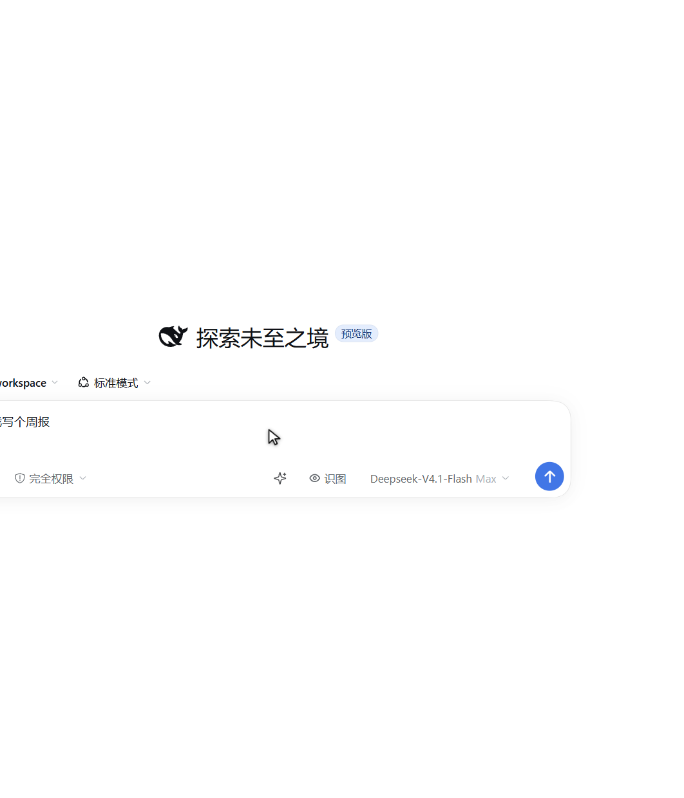
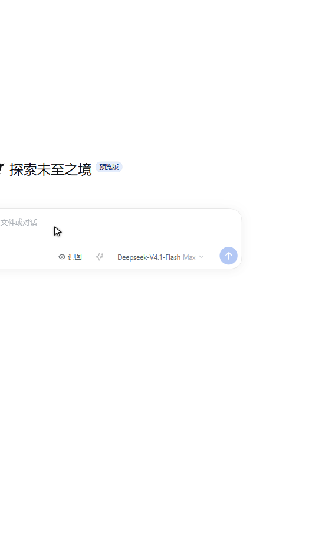
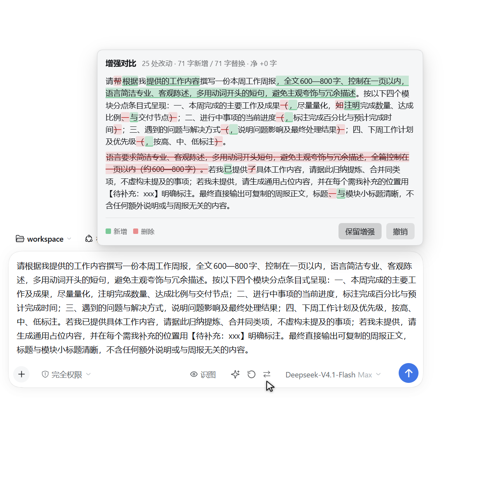

# dsh-prompt-enhance

DeepSeek Harness 的「增强提示词」插件：输入框右侧（模型选择器左边）多一个 ✨ 按钮，点一下就把草稿改写成更具体、更可执行的提示词；支持**多层撤销**与**逐字差异对比**。交互对标 WorkBuddy 的 ✨。



```
草稿「帮我写个周报」
   ↓ 点 ✨
草稿「请帮我撰写一份本周工作周报，要求：1) 分「本周进展 / 风险与阻塞 / 下周计划」三段…」
   ↓ 再点一次
草稿「帮我写个周报」   ← 原文完整恢复
```

## 为什么不是直接调 WorkBuddy 的增强模型

WorkBuddy 的 ✨ 走的是官方客户端专用模型 `global:enhance-1.0`（Enhance-1.0），中继要求请求带官方客户端签名，第三方调用一律被渠道校验挡掉（`request illegal` / `no_healthy_account`）。因此本插件复用 DSH 自己的 chat 模型 + **逐字复刻的 WorkBuddy 增强提示词**（`lib/prompt.mjs`），效果对齐而不依赖官方客户端。

## 结构（一个包，两个半边）

| 半边 | 文件 | 职责 |
| --- | --- | --- |
| 宿主 | `lib/index.js` | 注册 `POST /dsh-prompt-enhance/api/enhance`，校验浏览器会话，单轮调用 `ctx.llm.stream()`，无工具、不写会话历史 |
| 浏览器 | `lib/client.js` | 在 `conversation.input.right` 槽位渲染 ✨ 按钮，读写草稿、维护撤销点 |
| 提示词 | `lib/prompt.mjs` | 逐字复刻的 system prompt + user prompt 模板 + 输出清洗 |

### HTTP 契约

```
POST /dsh-prompt-enhance/api/enhance
  body: {
    "text": "<草稿原文>",                      # 必填，上限 20000 字符，body 上限 256KiB
    "provider": "acme",                       # 可选：界面当前模型，宿主按白名单校验
    "model": "cn:deepseek-v4.1-flash",        # 可选
    "reasoningEffort": "max"                  # 可选
  }
  200 : {"text": "<增强后的提示词>", "provider": "...", "model": "...", "followed": true|false}
  400 : EMPTY_INPUT | INPUT_TOO_LONG | INVALID_JSON
  401/403 : 无浏览器会话（隧道或未登录外部访问）
  405 : METHOD_NOT_ALLOWED
  502 : LLM 失败（NO_ADAPTER / AUTH / RATE_LIMIT / CONTEXT_WINDOW_EXCEEDED …）
  503 : 宿主没有 llm 服务
  504 : TIMEOUT（默认 120s）

GET /dsh-prompt-enhance/api/health
  200 : {"ok":true,"provider":"acme","model":"cn:deepseek-v4.1-flash"}
```

`provider`/`model`/`reasoningEffort` 只接受 `[A-Za-z0-9][A-Za-z0-9._:/@+-]{0,199}` 形状的标识符；任一不合法就整组忽略、退回插件默认模型，请求体无法决定任意上游路由。

认证复用 `dsh-client-connection` 的浏览器 Cookie 校验：DSH Web 端口可能被 cloudflared 隧道暴露（本机曾见 `59543`、重启后为 `56531`），没有这层栅栏，本端点会变成公网可用的免费模型代理。

### 客户端交互细节

- 空草稿 → 按钮置灰；有草稿才可点。
- 点击 → 转圈；**加载中再点 = 取消**（abort 请求，草稿不动）。
- 成功 → 原地替换草稿，旁边出现两个小按钮：**↺ 撤销**（可逐层回退，最多 8 层）与 **⇄ 差异**。
- **多层撤销**：对已增强的文本再点 ✨ 会再增强一层并压栈，↺ 一次退一层，退到栈空回原文。
- **差异高亮**：增强后自动弹出对比卡（逐字标出删除线与新增高亮、处数与净增字数），Escape 关闭，卡片上可直接「撤销」。
- 用户在等待期间改了草稿 → **放弃增强结果**，绝不覆盖用户输入。
- 成功后又继续编辑 → 撤销栈作废、差异卡关闭，不会把旧文本盖回来。
- 失败 → 按钮短暂变红，hover 显示中文原因，再点即重试。
- **跟随界面当前模型**：客户端把模型选择器里的 `provider/model/推理档` 带进请求，宿主校验格式后透传给 `ctx.llm.stream`；读不到模型时退回插件配置的默认模型。

### 差异卡的可读性约定（0.2.1）

差异卡此前按深色主题挑色（`#7ee2a8` / `#ff9d98`），浅色主题下是「浅色字压白底」——实测对比度只有 1.5:1 / 1.8:1，远低于 WCAG AA 的 4.5:1。现在：

- 新增段 `color: inherit`（跟随主题正文色）+ 20% 绿底 + 底部绿线；删除段文字由 `color-mix(in srgb, currentColor 82%, #b91c1c)` 推导 + 删除线。实测浅色 14.0:1 / 13.1:1、深色 10.5:1 / 7.9:1。
- 不只靠颜色区分：新增带下划线色块、删除带删除线，卡片底部还有「新增 / 删除」色块图例。
- 正文 13px / 行高 1.6，差异段按换行切行渲染（长提示词不再是"一大坨"）。
- 浮层锚在整张输入卡上方（不是 ✨ 按钮），高度按可用空间算，超长时正文内部滚动；宽度 `min(560px, 100vw − 24px)` 并随窗口尺寸重新定位。

## 真机验收（2026-10-19，DSH 重启后实测）

位置与 WorkBuddy 对齐：✨ 落在 `conversation.input.right` 槽位，`order: 50`，排在视觉路由的「识图」（order 40）之后，**紧贴模型选择器左侧**。

| 步骤 | 实测结果 | 证据 |
| --- | --- | --- |
| 空草稿 | 按钮置灰不可点（`disabled=true`，title「增强提示词」） | `docs/03-disabled.png` |
| 输入「帮我写个周报」 | ✨ 亮起，位于「Deepseek-V4.1-Flash」左侧 | `docs/01-before.png` |
| 真实点击 ✨ | 转圈 → 原地改写成结构化提示词，右侧出现 ↺（撤销）与 ⇄（差异）两个小按钮 | `docs/02-enhanced.png` |
| 差异卡 | 增强完成自动弹出（portal 到 `body`，浮在输入卡上方，不遮草稿），逐字绿底新增 / 红底删除线，Escape 关闭；实测 560×337、`overlapsComposer=false` | `docs/04-diff.png` |
| 主题可读性 | 新增/删除文字色都由主题色推导：浅色 14.0:1 / 13.1:1，深色 10.5:1 / 7.9:1（均 ≥ WCAG AA 4.5:1） | `getComputedStyle` 实测对比度 |
| 多层撤销 | 连点两次 ✨（depth 2）→ ↺ 一次退到第一版（93 字）→ 再 ↺ 逐字回到原文「帮我写个周报」，撤销按钮消失、父节点从 `span.dsh-prompt-enhance__group` 退回裸按钮 | 浏览器断言 `data-depth` 2→1→0 |
| 模型跟随（界面侧） | 拦截请求体实测 `{"text":…,"provider":"acme","model":"cn:deepseek-v4.1-flash","reasoningEffort":"max"}`——模型选择器当前档位被完整带进请求 | fetch 录制 |
| 模型跟随（宿主侧） | 显式传 `cn:deepseek-v4-pro` + `high` → 200、响应回显该模型且 `followed:true`；传非法标识符 `../etc/passwd` → 回落 `cn:deepseek-v4.1-flash`、`followed:false` | 同源 fetch 直测 |
| 同源 API 直测 | 200 正常；空白→`EMPTY_INPUT`；坏 JSON→`INVALID_JSON`；超长→`INPUT_TOO_LONG` | 均为 400，符合契约 |

改代码后的生效方式：**客户端半（`lib/client.js`）改完刷新页面即可**（bundle 每次页面加载重新取），宿主半（`lib/index.js`、`lib/prompt.mjs`）必须重启 DSH。

### 开发调试：怎么拿到带认证的 GUI URL

DSH Web 只认 `dsh web` 打印的带 token 链接，直连端口会看到 `dsh web authentication required`。仓库里的 `tools/gui-cookie.mjs` 用本机凭据库换出一枚短期会话 Cookie，方便在浏览器或自动化脚本里走查（**只在本机使用，不要外传它打印的 Cookie**）：

```powershell
cd $env:USERPROFILE\.dsh\dsh-prompt-enhance
node tools\gui-cookie.mjs --check 127.0.0.1:<port>        # 校验：打印 Cookie 并用它请求一次 GUI
node tools\gui-cookie.mjs --serve 59611 127.0.0.1:<port> # 本地跳板：浏览器打开 http://127.0.0.1:59611/
```

端口每次启动 DSH 都会变，以启动横幅 / runtime context 显示的为准；跳板端口（59611）可固定，只需换掉第二个参数。

## 配置

`cordis.patch.yml` 里的行可以带 `config`，逐键覆盖 `lib/index.js` 的 `DEFAULTS`：

```yaml
- insert:
    - id: dsh-prompt-enhance
      name: 'dsh-prompt-enhance'
      config:
        provider: acme                    # 客户端读不到界面模型时用它
        model: cn:deepseek-v4.1-flash
        reasoningEffort: ''              # 空 = 不显式传推理档
        maxInputChars: 20000
        timeoutMs: 120000
        systemPrompt: ''        # 非空则整体替换内置 system prompt
```

## 安装

```bash
dsh plugin add github:wjf1/dsh-prompt-enhance     # 装进当前 profile
# 或在插件市场（dshmarket）里搜 dsh-prompt-enhance 后一键安装
```

装完**需要重启一次 DSH**：宿主半的路由在插件图构建时注册。之后只改 `lib/client.js` 的话刷新页面即可生效。

卸载：`dsh plugin remove dsh-prompt-enhance`（或从 profile 的 `dsh.profile.bundles` 删掉该行），重启。

本地开发态（不经过 registry，直接链目录）：

```powershell
$src = "$env:USERPROFILE\.dsh\dsh-prompt-enhance"          # 本仓库位置
$profile = "$env:USERPROFILE\.dsh\profiles\desktop"        # 你的 profile 目录
cmd /c mklink /J "$profile\node_modules\dsh-prompt-enhance" "$src"
# 再把 "dsh-prompt-enhance" 加进 $profile\package.json 的 dsh.profile.bundles，重启 DSH
```

## 测试

```powershell
cd $env:USERPROFILE\.dsh\dsh-prompt-enhance
node --test "tests/*.test.mjs"        # Node 22+，33 个用例
```

- `tests/host.test.mjs`：路由守卫、认证栅栏、空/超长/坏 JSON、模型错误透传、空增强、缺 llm 服务。
- `tests/prompt.test.mjs`：两份模板的语言约束与示例未被删、`$` 序列不被替换、围栏/引号清洗。
- `tests/client.test.mjs`：用最小 hook 运行时驱动组件，验证「点击→busy→替换→撤销→取消→被用户编辑时放弃→失败重试」全部状态迁移。

## 已知边界

- 只做单轮增强，不带会话上下文（与 WorkBuddy 一致）；想要「结合历史」需要另设计。
- 模型跟随依赖客户端能读到 `modelDirectories`：读不到（服务缺失、会话无目录）就静默回落配置里的 `provider/model`，不会报错给用户。
- 撤销栈最多 8 层，且**等待期间用户改动草稿会整栈作废**（避免把旧文本盖回来）。
- 差异高亮是词级 LCS（空白/单汉字/拉丁词/单字符切分），token 上限 800；超长草稿会退化成正文字符级对比。
- 客户端半改动刷新页面即生效；但**如果刷新前 bundle 已被浏览器/服务端缓存**，要确认页面确实拿到了新文件（本次踩过一次：restart 与手改代码交错，首屏是旧 bundle，现页刷新后才出现 ↺/⇄ 与 `span.dsh-prompt-enhance__group`）。
- 客户端半的样式用内联 `<style>` 注入（id `dsh-prompt-enhance-style`），类名统一 `dsh-prompt-enhance__` 前缀避免与其它插件撞车。

## 与已有插件的关系

生态里已有若干「提示词增强」类插件（例如 npm 上的同名包 `dsh-prompt-enhance`，作者 rongxingda）。本仓库是**独立实现**，没有复用它们的代码，差异在于：

- 提示词是对 WorkBuddy 增强功能的**逐字复刻**（`lib/prompt.mjs`），不是通用「优化」模板；
- **多层撤销栈**（最多 8 层）——增强结果可以再增强，逐层回退；
- **逐字差异对比卡**——增强后自动弹出，标出新增/删除与处数、净增字数，可直接在卡上撤销；
- **跟随界面当前模型**：模型选择器换了档位，下一次增强就跟着换，无需另配「增强专用模型」。

---

## English

A DeepSeek Harness plugin that puts a ✨ button left of the model selector in the composer. One click rewrites the draft into a clearer, more executable prompt; the original is always recoverable.

### Features

- **One-click rewrite** of the composer draft, in place — no dialog, no send.
- **Multi-level undo** (up to 8 layers): enhance an already-enhanced draft and step back one layer at a time with `↺`.
- **Token-level diff** (`⇄`, shown automatically after each enhancement): added/removed spans with counts and net character delta, opened as a card above the composer. `Escape` closes it; "撤销 / Undo" is one click away.
- **Follows the session model**: the client sends the provider/model/reasoning effort currently selected in the model picker; the host validates the shape and falls back to the configured default if it cannot read it.
- **Host-side LLM call only**: the browser never sees an API key. The route sits behind the browser-session cookie fence (`dsh-client-connection`), so a tunnelled port cannot be abused as a free model proxy.
- **Safe by default**: empty draft → button disabled; clicking while a request runs cancels it; editing the draft while waiting discards the result instead of overwriting your text; failures turn the button red with a Chinese reason and clicking again retries.

### Install

```bash
dsh plugin add github:wjf1/dsh-prompt-enhance
```

Restart DSH once so the host half registers its route. Changes to `lib/client.js` alone take effect on page refresh.

### HTTP API

```
POST /dsh-prompt-enhance/api/enhance
  {"text": "<draft>", "provider": "acme", "model": "cn:deepseek-v4.1-flash", "reasoningEffort": "max"}
  → 200 {"text": "<enhanced>", "provider": "...", "model": "...", "followed": true|false}
  → 400 EMPTY_INPUT | INPUT_TOO_LONG | INVALID_JSON
  → 401/403 no browser session
  → 405 METHOD_NOT_ALLOWED
  → 502 LLM failure (NO_ADAPTER / AUTH / RATE_LIMIT / CONTEXT_WINDOW_EXCEEDED …)
  → 503 no LLM service in the host
  → 504 TIMEOUT (default 120 s)

GET /dsh-prompt-enhance/api/health
  → 200 {"ok": true, "provider": "...", "model": "..."}
```

`provider` / `model` / `reasoningEffort` must match `[A-Za-z0-9][A-Za-z0-9._:/@+-]{0,199}`; if any of them does not, the whole override is ignored and the configured default is used.

### Why not call WorkBuddy's own enhance model

WorkBuddy's ✨ uses the official-client-only model `global:enhance-1.0`; the relay rejects third-party callers (`request illegal` / `no_healthy_account`). This plugin reuses DSH's own chat model with WorkBuddy's enhancement prompts copied verbatim (`lib/prompt.mjs`), so the wording matches without depending on the official client.

### Configuration

Any key of `DEFAULTS` in `lib/index.js` can be overridden through the plugin's `config` block in the profile patch:

```yaml
- insert:
    - id: dsh-prompt-enhance
      name: 'dsh-prompt-enhance'
      config:
        provider: acme                 # used when the client cannot read the session model
        model: cn:deepseek-v4.1-flash
        reasoningEffort: ''            # empty = do not send an explicit effort
        maxInputChars: 20000
        timeoutMs: 120000
        systemPrompt: ''               # non-empty replaces the built-in system prompt
```

### Tests

```powershell
node --test "tests/*.test.mjs"
```

33 cases across three suites: host route guards/authentication/model-failure passthrough, prompt template integrity and output cleaning, and the client state machine driven by a minimal hook runtime (click → busy → replace → undo → cancel → discard-on-edit → retry).

### Known limitations

- Single turn, no conversation context — matching WorkBuddy's behaviour.
- Model following needs `modelDirectories` on the client; when unavailable it silently falls back to the configured default.
- Undo stack holds at most 8 layers, and editing the draft while a request is in flight clears it.
- Diff is word-level LCS with an 800-token cap; longer drafts degrade to a character-level comparison.

### Screenshots

| | |
| --- | --- |
|  |  |
| Draft with the ✨ button enabled | After enhancement: `↺` undo + `⇄` diff appear |
|  |  |
| Disabled while the draft is empty | Diff card: added/removed spans and counts |

### License

MIT
